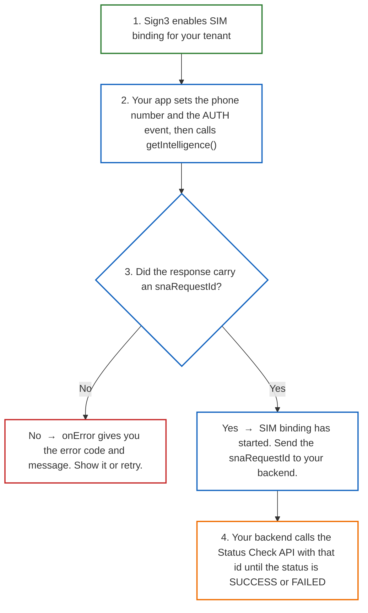

# Sign3 SIM Binding SDK Integration Guide for Android

The Sign3 SIM Binding SDK verifies that the phone number a user claims is the number of the SIM in the device they are holding. It does this carrier-side, over the cellular data interface, through Silent Network Authentication (SNA): nothing is sent to the user. When the carrier cannot answer, the flow falls back to an SMS OTP, which the SDK reads and verifies on its own.

The SDK is headless and is driven entirely by the Sign3 Intelligence SDK. There is nothing to call and nothing to handle on the device; you only read the transaction id off the intelligence response and, from your backend, ask the Sign3 status API what became of it.

<br>

## Adding the SIM Binding SDK to Your Project

1. **Configure the Repository in `settings.gradle`**
    - Open your project's `settings.gradle` file and add the Sign3 JFrog repository to the `dependencyResolutionManagement` block. Please collect the **username** and **password** from the credentials document.

      **Groovy (`settings.gradle`)**

      ```groovy
      dependencyResolutionManagement {
          repositoriesMode.set(RepositoriesMode.FAIL_ON_PROJECT_REPOS)
          repositories {
              google()
              mavenCentral()
              maven { url 'https://jitpack.io' }
              maven {
                  url "https://sign3.jfrog.io/artifactory/intelligence-generic-local/"
                  credentials {
                      username = "provided in credential doc"
                      password = "provided in credential doc"
                  }
              }
          }
      }
      ```

      **Kotlin DSL (`settings.gradle.kts`)**

      ```kotlin
      dependencyResolutionManagement {
          repositoriesMode.set(RepositoriesMode.FAIL_ON_PROJECT_REPOS)
          repositories {
              google()
              mavenCentral()
              maven { url = uri("https://jitpack.io") }
              maven {
                  url = uri("https://sign3.jfrog.io/artifactory/intelligence-generic-local/")
                  credentials {
                      username = "provided in credential doc"
                      password = "provided in credential doc"
                  }
              }
          }
      }
      ```

2. **Add the SIM Binding SDK Dependency in App-Level Gradle**

   ```groovy
   dependencies {
       // Sign3 Intelligence, which drives SIM binding
       implementation 'com.sign3.intelligence:intelligence-playstore-lite:5.x.x'

       // Sign3 SIM Binding
       implementation 'com.sign3.simbinding:intelligence-playstore:1.x.x'
   }
   ```
    - Sign3 Intelligence: checkout the [latest_version](https://github.com/Sign3labs/sdk-integration-guide/tree/main?tab=readme-ov-file#changelog)
    - Sign3 SIM Binding: checkout the [latest version](#changelog)

3. **After adding the dependency, sync your project with Gradle files to ensure the library is properly integrated.**

<br>

## App Permission

Add the following permissions to your app's `AndroidManifest.xml`. The SDK itself declares only `INTERNET`; the rest belong to your app because SNA has to reach the carrier over the cellular data interface and has to know which SIM is active.

```permission
<uses-permission android:name="android.permission.INTERNET" />
<uses-permission android:name="android.permission.ACCESS_NETWORK_STATE" />
<uses-permission android:name="android.permission.CHANGE_NETWORK_STATE" />
<uses-permission android:name="android.permission.READ_PHONE_STATE" />
```

### Network security config

Once you have successfully integrated the Sign3 SIM Binding SDK in your application, add the following line in your app's AndroidManifest file in the `<application>` tag:

```xml
<application
    android:networkSecurityConfig="@xml/sign3_network_security_config"
    ... >
```

If your app already has its own `networkSecurityConfig`, do not replace it. Instead, add the following inside your existing `<network-security-config>`:

```xml
<domain-config cleartextTrafficPermitted="true">
    <domain includeSubdomains="true">80.in.safr.sekuramobile.com</domain>
    <domain includeSubdomains="true">partnerapi.jio.com</domain>
    <domain includeSubdomains="true">in-vil.ipification.com</domain>
    <domain includeSubdomains="true">api-csp.airtel.in</domain>
    <domain includeSubdomains="true">v4-api-csp.airtel.in</domain>
</domain-config>
```

<br>

## Initializing the SDK

1. Initialize the SDK in the `onCreate()` method of your Application class.
2. Use the ClientID and Client Secret shared with the credentials document.
3. The SDK require a minimum SDK version of 23 if your app is targeting below this version must enclose Sign3 API calls within conditional checks.

### For Kotlin

```kotlin
override fun onCreate() {
    super.onCreate()

    // Other initialisation code
    if (Build.VERSION.SDK_INT >= Build.VERSION_CODES.M) {
        val options = Options.Builder()
            .setClientId("<SIGN3_CLIENT_ID>")
            .setClientSecret("<SIGN3_CLIENT_SECRET>")
            .setSSLPinning(true) // Optional: If you want SSL pinning in API calls, default value is false.
            .setEnvironment(if (BuildConfig.DEBUG) Options.ENV_DEV else Options.ENV_PROD) // For Prod: Options.ENV_PROD, For Dev: Options.ENV_DEV
            .build()

        Sign3Intelligence.getInstance(this).initAsync(options) {
            // to check if the SDK is initialized correctly or not
            Log.i("TAG_AppInstance", "Sign3Intelligence init : $it")
        }
    }

}
```

### For Java

```java
@Override
public void onCreate() {
    super.onCreate();

    // Other initialisation code
    Options options = new Options.Builder()
            .setClientId("<SIGN3_CLIENT_ID>")
            .setClientSecret("<SIGN3_CLIENT_SECRET>")
            .setSSLPinning(true) // Optional: If you want SSL pinning in API calls, default value is false.
            .setEnvironment(BuildConfig.DEBUG ? Options.ENV_DEV : Options.ENV_PROD) // For Prod: Options.ENV_PROD, For Dev: Options.ENV_DEV
            .build();

    if (Build.VERSION.SDK_INT >= Build.VERSION_CODES.M) {
        Sign3Intelligence.getInstance(this).initAsync(options);
    }
}
```
<br>

## Starting SIM Binding

Ask Sign3 to enable SIM binding for your tenant. Once SIM binding is enabled, you do not need to call the SIM binding SDK separately. The Sign3 Intelligence SDK internally handles the SNA and SMS flow.

1. Based on your requirements, we will create a `templateID` for SNA, SMS, or SNA + SMS authentication and use that template ID for authentication.
2. Set the user's phone number using updateOptions, including the country code without + or spaces (e.g., 919876543210), and set the UserEventType to AUTH. SIM binding runs only for the AUTH event type; it is not triggered for LOGIN, SIGNUP, TRANSACTION or OTHERS.
3. Call `getIntelligence()`.
4. On success, `onSuccess` receives an `IntelligenceResponse` whose `snaRequestId` holds the SNA request id. On failure, `onError` receives an `IntelligenceError` whose `errorMessage` carries the error code, message and description. Once you receive the `snaRequestId`, you need to poll the `Status Check API` to check the status of the SNA request. You can poll the Status Check API from your backend through the `Login API` until the SNA request reaches a final status. The recommended approach is to make a backend-to-backend call to perform the status check.


NOTE: Options are reset after every score, so update them again before each AUTH score.

### For Kotlin

```kotlin
val updateOptions = UpdateOptions.Builder()
    .setPhoneNumber("919876543210")        // Pass the phone number with the country code
    .setUserEventType(UserEventType.AUTH) // Set UserEventType.AUTH to initiate SIM binding
    .build()

Sign3Intelligence.getInstance(this).updateOptions(updateOptions)

Sign3Intelligence.getInstance(this).getIntelligence(object : IntelligenceListener {
    override fun onSuccess(response: IntelligenceResponse) {
        val snaRequestId = response.snaRequestId
        if (snaRequestId.isNullOrEmpty()) {
            // SIM binding was not started for this request. Handle the Intelligence Response as required.
        } else {
            // ⭐ Recommended: Poll the Status Check API from your backend to check whether SIM binding is pending, successful, or failed.
            Log.i("Sign3SimBinding", "SIM binding started with snaRequestId $snaRequestId")
        }
    }

    override fun onError(error: IntelligenceError) {
        // SIM binding could not be started or failed. Check IntelligenceError for the error code, message, and description.
        Log.e("Sign3SimBinding", "requestId=${error.requestId} ${error.errorMessage}")
    }
})
```

### For Java

```java
UpdateOptions updateOptions = new UpdateOptions.Builder()
        .setPhoneNumber("919876543210")        // Pass the phone number with the country code
        .setUserEventType(UserEventType.AUTH) // Set UserEventType.AUTH to initiate SIM binding
        .build();

Sign3Intelligence.getInstance(this).updateOptions(updateOptions);

Sign3Intelligence.getInstance(this).getIntelligence(new IntelligenceListener() {
    @Override
    public void onSuccess(IntelligenceResponse response) {
        String snaRequestId = response.getSnaRequestId();
        if (snaRequestId == null || snaRequestId.isEmpty()) {
            // SIM binding was not started for this request. Handle the Intelligence Response as required.
        } else {
            // ⭐ Recommended: Poll the Status Check API from your backend to check whether SIM binding is pending, successful, or failed.
            Log.i("Sign3SimBinding", "SIM binding started with snaRequestId " + snaRequestId);
        }
    }

    @Override
    public void onError(IntelligenceError error) {
        // SIM binding could not be started or failed. Check IntelligenceError for the error code, message, and description.
        Log.e("Sign3SimBinding", "requestId=" + error.getRequestId() + " " + error.getErrorMessage());
    }
});
```

> [!IMPORTANT]
> **Recommended:** Once you receive the `snaRequestId`, poll the Status Check API from your backend to check whether SIM binding is pending, successful, or failed. Keep polling until it reaches a success/failed status. Never call the Status Check API from the app side, since a status checked on the device can be tampered and the credentials would be exposed.

<br>

### SIM Binding Result

The HTTP status below is the one the SIM binding backend returned to the Intelligence SDK when it opened the transaction. On `200` the SDK calls `onSuccess` with an `IntelligenceResponse` carrying the `snaRequestId`. On `400` and `401` the SDK calls `onError` with an `IntelligenceError` whose `errorMessage` is `<errorCode>: <errorMessage> - <errorDescription>` and whose `requestId` is the Sign3 request id.

#### Status code `200` — The transaction was opened

<table>
<tr>
<th align="left" width="495">✅ SNA request id received</th>
</tr>
<tr>
<td valign="top" width="495">

```json
{
  "snaRequestId": "ARID_A1B2C3D4E5F6"
}
```

</td>
</tr>
</table>

#### Status code `400` — The request was not accepted

<table>
<tr>
<th align="left" width="330">⚠️ 7119 · Invalid request Id</th>
<th align="left" width="330">⚠️ 7106 · Invalid phoneNumber or email</th>
<th align="left" width="330">⚠️ 7102 · Invalid phone number</th>
<th align="left" width="330">⚠️ 7104 · Invalid email</th>
<th align="left" width="330">⚠️ 7113 · Invalid expiry</th>
</tr>
<tr>
<td valign="top" width="330">

```json
{
  "requestId": "6f1c2a7e-3b9d-4c58-a1e2-9d7b5f0c4e21",
  "errorMessage": "7119: Invalid Request - Request error: Invalid request Id"
}
```

</td>
<td valign="top" width="330">

```json
{
  "requestId": "6f1c2a7e-3b9d-4c58-a1e2-9d7b5f0c4e21",
  "errorMessage": "7106: Invalid Request - Request error: Invalid phoneNumber or email."
}
```

</td>
<td valign="top" width="330">

```json
{
  "requestId": "6f1c2a7e-3b9d-4c58-a1e2-9d7b5f0c4e21",
  "errorMessage": "7102: Invalid Request - Request error: Invalid phone number"
}
```

</td>
<td valign="top" width="330">

```json
{
  "requestId": "6f1c2a7e-3b9d-4c58-a1e2-9d7b5f0c4e21",
  "errorMessage": "7104: Invalid Request - Request error: Invalid email"
}
```

</td>
<td valign="top" width="330">

```json
{
  "requestId": "6f1c2a7e-3b9d-4c58-a1e2-9d7b5f0c4e21",
  "errorMessage": "7113: Invalid Request - Request error: Invalid expiry"
}
```

</td>
</tr>
<tr>
<th align="left" width="330">⏱️ 9001 · Timeout Error</th>
<th align="left" width="330">⚠️ 9003 · Invalid phone number format</th>
<th align="left" width="330">⚠️ 9004 · Template id not configured</th>
</tr>
<tr>
<td valign="top" width="330">

```json
{
  "requestId": "6f1c2a7e-3b9d-4c58-a1e2-9d7b5f0c4e21",
  "errorMessage": "9001: Timeout Error - Sign3 SIM binding creation timed out."
}
```

</td>
<td valign="top" width="330">

```json
{
  "requestId": "6f1c2a7e-3b9d-4c58-a1e2-9d7b5f0c4e21",
  "errorMessage": "9003: Invalid Request - Sign3 SIM binding requires a phone number containing the country code followed by the subscriber number."
}
```

</td>
<td valign="top" width="330">

```json
{
  "requestId": "6f1c2a7e-3b9d-4c58-a1e2-9d7b5f0c4e21",
  "errorMessage": "9004: Invalid Request - The SIM binding template ID is not configured for this tenant."
}
```

</td>
</tr>
</table>

#### Status code `401` — The tenant was not authorised

<table>
<tr>
<th align="left" width="330">🔒 7012 · Credentials empty</th>
<th align="left" width="330">🔒 7002 · Invalid credentials</th>
<th align="left" width="330">🔒 7019 · Merchant blocked</th>
</tr>
<tr>
<td valign="top" width="330">

```json
{
  "requestId": "6f1c2a7e-3b9d-4c58-a1e2-9d7b5f0c4e21",
  "errorMessage": "7012: Access blocked - Authorization error: Merchant credentials are empty"
}
```

</td>
<td valign="top" width="330">

```json
{
  "requestId": "6f1c2a7e-3b9d-4c58-a1e2-9d7b5f0c4e21",
  "errorMessage": "7002: Access blocked - Authorization error: Invalid credentials"
}
```

</td>
<td valign="top" width="330">

```json
{
  "requestId": "6f1c2a7e-3b9d-4c58-a1e2-9d7b5f0c4e21",
  "errorMessage": "7019: Merchant Blocked - Your account has been temporarily Blocked. Please contact support for assistance."
}
```

</td>
</tr>
<tr>
<th align="left" width="330">🔒 9002 · Tenant credentials not configured</th>
<th align="left" width="330">🔒 9005 · SIM binding not enabled</th>
</tr>
<tr>
<td valign="top" width="330">

```json
{
  "requestId": "6f1c2a7e-3b9d-4c58-a1e2-9d7b5f0c4e21",
  "errorMessage": "9002: Access blocked - Sign3 SIM binding tenantId or tenantSecret is not configured for this tenant."
}
```

</td>
<td valign="top" width="330">

```json
{
  "requestId": "6f1c2a7e-3b9d-4c58-a1e2-9d7b5f0c4e21",
  "errorMessage": "9005: Access blocked - Sign3 SIM binding is not enabled for this tenant."
}
```

</td>
</tr>
</table>

<br>


## Checking the SIM Binding Status

The score returns as soon as the transaction is open; the binding itself finishes afterwards. Ask the status API what became of the `snaRequestId`.

**Call this from your backend.** The credentials below are your tenant id and tenant secret, and they must not ship in the app. The sample app calls it from the device only so the flow can be demonstrated on one screen.

### Request

```bash
curl --location 'https://intelligence.sign3.in/auth/v1/status?requestId=ARID_411A767110E0422FA06F9CF14F2B8E34' \
--header 'Content-Type: application/json' \
--header 'Authorization: Basic <base64(tenantId:tenantSecret)>'
```

| | |
|---|---|
| Base URL | `https://intelligence.sign3.in` |
| Method | `GET` |
| Path | `/auth/v1/status` |
| Query | `requestId` — the `snaRequestId` from `IntelligenceResponse` |
| `Authorization` | `Basic` over `<tenantId>:<tenantSecret>`, both provided by Sign3 |

### Response

#### Status code `200` — The transaction is known

<table>
<tr>
<th align="left" width="330">✅ SUCCESS</th>
<th align="left" width="330">🟡 PENDING</th>
<th align="left" width="330">❌ FAILED</th>
</tr>
<tr>
<td valign="top" width="330">

```json
{
  "auths": [
    {
      "identityType": "MOBILE",
      "identityValue": "917069914791",
      "channel": "SILENT_AUTH",
      "methods": [
        "SILENT_AUTH"
      ],
      "status": "SUCCESS",
      "verifiedTimestamp": 1781091069000,
      "type": "PRIMARY"
    }
  ],
  "derivedOperator": "AIRTEL",
  "phoneDetail": {
    "countryCode": "91",
    "country": "IN",
    "type": "MOBILE",
    "homeOperator": "VI",
    "location": "India",
    "timeZones": [
      "Asia/Calcutta"
    ]
  },
  "simDetail": {
    "operator": "AIRTEL",
    "mcc": 405,
    "mnc": 51
  },
  "networkDetail": {
    "ip": "2401:4900:1c50:1a3b::1",
    "ipType": "IPV6",
    "operator": "AIRTEL",
    "callback": {
      "ip": "2401:4900:aabb:f09e::68fa:fe37",
      "operator": "AIRTEL",
      "userAgent": "Chrome/147.0.0.0 Mobile Safari/537.36"
    }
  }
}
```

</td>
<td valign="top" width="330">

```json
{
  "auths": [
    {
      "identityType": "MOBILE",
      "identityValue": "917069914791",
      "channel": "SILENT_AUTH",
      "methods": [
        "SILENT_AUTH"
      ],
      "status": "PENDING",
      "type": "PRIMARY"
    }
  ],
  "derivedOperator": "AIRTEL",
  "phoneDetail": {
    "countryCode": "91",
    "country": "IN",
    "type": "MOBILE",
    "homeOperator": "VI",
    "location": "India",
    "timeZones": [
      "Asia/Calcutta"
    ]
  },
  "simDetail": {
    "operator": "AIRTEL",
    "mcc": 405,
    "mnc": 51
  },
  "networkDetail": {
    "ip": "2401:4900:1c50:1a3b::1",
    "ipType": "IPV6",
    "operator": "AIRTEL"
  }
}


```

</td>
<td valign="top" width="330">

```json
{
  "auths": [
    {
      "identityType": "MOBILE",
      "identityValue": "917069914791",
      "channel": "SILENT_AUTH",
      "methods": [
        "SILENT_AUTH"
      ],
      "status": "FAILED",
      "type": "PRIMARY",
      "error": {
        "errorCode": "SP40005",
        "message": "Operator not supported",
        "description": "This operator isn’t supported. Please try a different network."
      }
    }
  ],
  "derivedOperator": "JIO",
  "phoneDetail": {
    "countryCode": "91",
    "country": "IN",
    "type": "MOBILE",
    "homeOperator": "VI",
    "location": "India",
    "timeZones": [
      "Asia/Calcutta"
    ]
  },
  "simDetail": {
    "operator": "JIO",
    "mcc": 405,
    "mnc": 872
  },
  "networkDetail": {
    "ip": "49.204.148.177",
    "ipType": "IPV4"
  }
}


```

</td>
</tr>
</table>

#### Status code `400` — The request was not accepted

<table>
<tr>
<th align="left" width="495">⚠️ 7170 · Auth not started yet</th>
<th align="left" width="495">⚠️ 7119 · Invalid request Id</th>
</tr>
<tr>
<td valign="top" width="495">

```json
{
  "message": "Invalid Request",
  "errorCode": "7170",
  "description": "Auth not started yet. Please initiate authentication first."
}
```

</td>
<td valign="top" width="495">

```json
{
  "message": "Invalid Request",
  "errorCode": "7119",
  "description": "Request error: Invalid request Id"
}
```

</td>
</tr>
</table>

#### Status code `401` — The caller was not authorised

<table>
<tr>
<th align="left" width="330">🔒 7012 · Credentials empty</th>
<th align="left" width="330">🔒 7002 · Invalid credentials</th>
<th align="left" width="330">🔒 7019 · Merchant blocked</th>
</tr>
<tr>
<td valign="top" width="330">

```json
{
  "message": "Access blocked",
  "errorCode": "7012",
  "description": "Authorization error: Merchant credentials are empty"
}
```

</td>
<td valign="top" width="330">

```json
{
  "message": "Access blocked",
  "errorCode": "7002",
  "description": "Authorization error: Invalid credentials"
}
```

</td>
<td valign="top" width="330">

```json
{
  "message": "Merchant Blocked",
  "errorCode": "7019",
  "description": "Your account has been temporarily Blocked. Please contact support for assistance."
}
```

</td>
</tr>
</table>

<br>

## Flow Diagram

SIM binding in four simple steps: Sign3 switches it on, your app asks for a score, you get an id, and your backend checks what happened to it.



<br>

## Changelog
### 1.0.0
- Silent Network Authentication over the carrier network, with automatic fallback to SMS OTP and automatic OTP verification.
- Driven entirely by the Sign3 Intelligence SDK on `UserEventType.AUTH` scores; no API to call.
- `IntelligenceResponse.snaRequestId` carries the transaction id for the `/auth/v1/status` check; on failure `onError` receives an `IntelligenceError` whose `errorMessage` carries the error code, message and description.
- Ships its network security config and consumer ProGuard rules.
